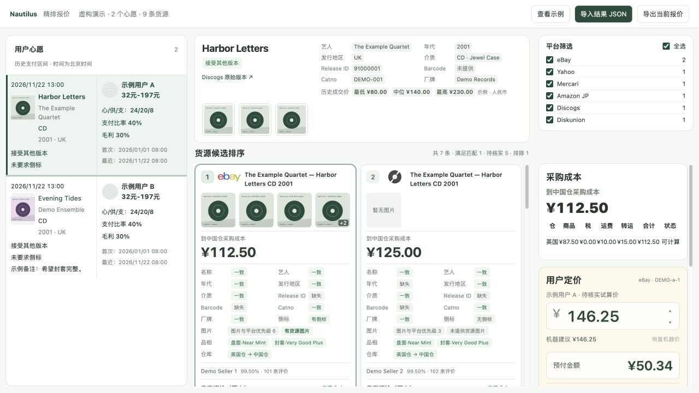

# Nautilus 精排报价前端

**把精排服务返回的 `nautilus-quote-result/1` JSON 直接渲染成报价工作台。** 纯 HTML / CSS / JavaScript，无框架、无 npm 依赖、无构建步骤，不需要启动精排服务。

保留现有页面的心愿栏、目标样图、货源卡片、平台筛选、原始商品链接、卖家原文弹窗、成本明细、服务器报价、预付金额与简短理由、报价图片选择、人工编辑和草稿导出。



```text
原平台后端 → 精排服务 → 完成的结果 JSON → 本前端
                                         ↓
                               人工确认后的报价草稿
                                         ↓
                             原平台自己的保存/发送接口
```

前端不调用 Flash，不重新精排、核验作品或生成报价。筛选只隐藏货源，不改变原始排名。人工编辑只影响草稿，服务器原结果保留。

## 本版定价与预付金额（1.1.1）

1.1.1 界面更新：预付数字放在左侧，与上方报价数字对齐；“用户定价”标题右侧不再显示平台和商品编号。计算与 JSON 协议不变。

- 服务器报价规则：到中国仓成本 ×（1＋用户原始 `priceratio`），四舍五入到分。例如 146.25 × 1.25 = **182.81 元**。这项“毛利”按成本加价解释，不是销售毛利率。
- `priceratio` 缺失或无效时，服务器返回 `quoteCny: null`；前端不填默认加价率，不生成报价。
- 预付金额读取 `quote_pricing.result.prepayment`。人工改价时，仅重新分配预付与尾款；总报价不变。旧结果未带该对象时，按相同版本规则兼容计算。
- 预付基准约为报价三分之一，在 ±10 元范围内稳定浮动，限制为 0.01 元至总价；同一用户、心愿、货源和金额刷新后不变。`remainingCny` 是尾款，预付＋尾款始终等于报价。
- 页面已去掉“下载图文素材”“复制报价说明”“内部参考”及展开的完整定价依据；底部按钮为“报价”。它仍保存本机草稿并触发 `nautilus:quote-saved`，尚未代替原平台的实际提交接口。

## 1. 先运行页面

```bash
git clone https://github.com/yvetteyan7/nautilus-quote-frontend.git
cd nautilus-quote-frontend
python3 -m http.server 19024 --bind 127.0.0.1
```

打开 <http://127.0.0.1:19024/>。也可使用 `npm start`，无需 `npm install`。

- 默认加载 **2 个虚构心愿、9 条虚构货源**，覆盖六个平台、无图、缺成本、排除项等状态。
- 点击顶部 **导入结果 JSON**，选择精排接口返回的完整结果文件；在浏览器内解析，不上传文件。
- 不要导入原始找货 JSON、任务状态 JSON 或外包一层 `{data: result}` 的对象；后者应先取出 `data`。
- 请通过 HTTP(S) 打开，直接双击 `index.html` 的 `file://` 方式不支持加载示例。

仓库不含真实用户、历史跑批结果、API 密钥或服务端代码。示例图片也是本地生成的虚构图。

## 2. 研发接入：收到结果后传给页面

**推荐把本目录部署到原平台的同域路径，如 `/quote/`，业务后端保存精排结果，再交给此页面。** 精排服务的认证密钥只放业务后端。

在 `config.js` 中将 `autoLoad` 设为 `false`，页面就不会自动加载演示数据。也可使用 `/quote/?autoload=0`。

### 同页 JavaScript 调用

将下面逻辑放在自己的外部 JS 模块里，并在 `app.js` 后面用 `<script type="module" src="./integration.js"></script>` 引入。页面 CSP 默认禁止内联脚本。

```js
// 此时 app.js 已执行，NautilusQuote 已存在。
await window.NautilusQuote.ready;

// 这是原平台自己的同域接口，不是直接从浏览器调用精排服务。
const response = await fetch('/your-api/quotes/current/result', {
  credentials: 'same-origin'
});
if (!response.ok) throw new Error(`读取结果失败：${response.status}`);
const result = await response.json();
await window.NautilusQuote.loadResult(result);
```

若已有 JSON 对象，只需这一句：

```js
await window.NautilusQuote.loadResult(result);
```

也可以配置 `config.js` 的 `resultURL` 指向同域 JSON 地址，保持 `autoLoad: true`。`loadFromURL()` 只允许同域结果地址，沿用浏览器的同域登录会话。

### 嵌入现有平台

最少侵入的方式是同域 iframe，避免现有平台 CSS 与工作台样式互相覆盖：

```html
<iframe id="quote-frame" src="/quote/?autoload=0"
        title="精排报价工作台" width="100%" height="900"></iframe>
```

父页面外部 JS：

```js
const frame = document.querySelector('#quote-frame');
frame.addEventListener('load', async () => {
  try {
    const ui = frame.contentWindow.NautilusQuote;
    await ui.ready;
    await ui.loadResult(result); // result 是己方后端收到的完整精排结果
  } catch (error) {
    // 在原平台展示加载错误，不能把失败当作成功。
    console.error(error);
  }
});
```

可直接打开 [可运行的嵌入示例](examples/embed.html)。该示例从本仓库读取虚构 JSON，经公开 API 送入 iframe；没有伪造接口，也无需浏览器控制台。

父子页面必须同源；跨域 iframe 不能直接访问 `contentWindow.NautilusQuote`。如需跨域接入，请由对方实现带严格 origin 校验的消息桥；本仓库不提供匿名跨域接收入口。

## 3. 输入字段与页面的对应关系

完整可运行样例：[examples/demo-result.json](examples/demo-result.json)。接口结构及约束见 [docs/json-contract.md](docs/json-contract.md)。

| 返回 JSON 路径 | 展示位置 / 用途 |
| --- | --- |
| `releases[].wish_context` | 昵称、申请时间、历史支付区间、心/供/支、支付比率、毛利 |
| `releases[].requirements` | 接受其他版本、侧标要求、用户备注原文 |
| `basic / artist / identifiers` | 目标标题、艺人、年代、地区、介质、Release ID、Barcode、Catno、厂牌 |
| `cover / reference_images[]` | 目标 Discogs 样图，多图全部展开 |
| `sources[].ranking.rank` | 服务器全量排序；平台筛选时保持原序 |
| `sources[].ranking.candidate_rank` | 卡片上的候选序号；排除项为 `null`，显示 `—` |
| `ranking.tags / display_tags / unified_facts` | 名称、艺人、介质等判断标签，侧标状态 |
| `ranking.estimated_cost` | 到中国仓成本、各仓价格拆分 |
| `sources[].images / url` | 货源图片、原始商品页链接 |
| `condition.original_condition.comments` | 卖家评论弹窗；原始文本仍可查看 |
| `seller / seller_rate_percent` | 商家与好评数、好评率 |
| `quote_pricing.result / summary / reason` | 服务器建议价、一行定价理由 |
| `quote_copy.description` | 面向用户的报价说明；仅 `status=completed` 时作为默认内容 |
| `dimensions29` | 保留 01–29 原始字段及证据；页面不据此重新推断匹配结论 |
| `pricing_context.wishBindings / userProfiles` | 防止把另一位用户的价格显示到当前心愿 |

`null`、空数组和缺失状态保持原义，不能把“未知”变成“否”或“0”。金额为人民币数值，前端负责格式化。历史支付最低/最高价只是历史展示，不当成此次预算。

当前返回协议没有可靠的历史成交价字段：真实结果默认显示 `—`。可选扩展 `sales_history` 只负责展示；示例中的随机布局价格明确标注“示例”，不参与报价。

## 4. 人工编辑后如何接回业务系统

提供三种出口：

- `NautilusQuote.getSelection()`：读取当前选中货源、人工报价、说明和选中的**原图 URL**。
- 顶部“导出当前报价”：下载同一份 `nautilus-quote-draft/1` 草稿 JSON。
- 监听 `nautilus:quote-saved`：用户点击“报价”且通过金额校验后触发。

```js
window.addEventListener('nautilus:quote-saved', async ({detail: draft}) => {
  // 这里由原平台补上自己的保存接口、鉴权、权限校验和成功提示。
  // 草稿是客户端输入；后端须重新校验用户、货源、金额和图片归属。
  console.log(draft);
});
```

iframe 模式在 `frame.contentWindow` 上监听这个事件，而不是父页面的 window。可运行示例演示了这一点。

草稿包含 `wish_id`、`user_profile_id`、`release_id`、完整 `source_id`、`product_id`、原排名、`quote_cny`、机器建议价、`prepayment`、`description`、`image_urls`、`validation` 和结果标识。完整结构见协议文档。

**“保存到本机”不等于保存到平台，更不等于已发给用户。** 草稿存在浏览器 `localStorage`，按结果快照、用户和货源隔离。生产环境可把保存事件接到己方接口，再更改按钮及成功提示。`getSelection()` 和导出也允许查看尚未通过金额校验的草稿，调用方应检查 `validation.valid`；服务端仍必须复核。

## 5. 图片处理

- 输入使用 `image.url` 的原始 HTTP(S) 地址。返回包中的 `/media/<hash>` 是原精排服务器的代理路径；本静态页会忽略它，不会误拼到对方域名。
- 默认直接展示原图；`config.js.imageURL(url)` 可改成对方的同域图片代理地址。`loadResult(result, {imageURL})` 也支持逐次覆盖。
- 页面保留图片选择与预览；草稿导出原图 URL，由业务系统按选中的图片报价。
- HTTPS 页面里的 HTTP 图片可能被浏览器拦截，应通过己方 HTTPS 代理解决。
- 报价默认选择前四张货源图，可增减；目标版本参考图不混进报价图片。导出草稿始终保留原图 URL。
- 图片代理由业务后端维护：限制来源域名/内网访问、校验响应类型、设置体积及超时上限。本仓库不附开放代理。

## 6. 部署与接入 API

将这些文件放进任意静态文件服务器：

```text
index.html
config.js
app.js / result-adapter.js / returned-pricing.js
rerank-ui.js / tags-ui.js / quote-users.js
quote-images.js / quote-descriptions.js / platform-filter.js
style.css
assets/
examples/                 # 仅在需要演示时部署；生产可关闭自动演示
```

不需要复制 Python、精排代码、原始 JSON、`.git` 或本地 `private/` 目录。支持站点根路径和 `/quote/` 等子路径，无需 Node 服务进程。若删掉示例目录，同时去掉演示按钮或保留该目录，避免按钮产生 404。

| API / 事件 | 行为 |
| --- | --- |
| `NautilusQuote.ready` | DOM 与调用入口已就绪；不代表自动加载已完成 |
| `loadResult(result, {releaseId?, imageURL?})` | 校验并替换整个结果；返回 Promise，失败抛错；不会合并旧心愿 |
| `loadFromURL(url)` | 从同域地址读取结果后加载，返回 Promise |
| `getSelection()` | 当前人工报价草稿；无货源时为 `null` |
| `getResult()` | 原始导入结果的副本；不包含人工修改 |
| `nautilus:loaded` | 导入成功，附结果标识、心愿数、货源数 |
| `nautilus:quote-saved` | 本机草稿保存成功，附草稿对象 |
| `nautilus:error` | 内置导入按钮/自动加载失败；直接调用 API 时由调用方 catch |

生产配置建议：HTML、配置和 JSON 使用可更新缓存策略；静态资源用版本化发布目录；真实结果接口使用己方鉴权并设置私有缓存策略。页面无字体 CDN、分析埋点或第三方 JS。

`index.html` 已给脚本和样式加 `?v=1.1.1`。后续升级时同步修改资源版本，或使用新的版本目录，避免新 HTML 配上旧缓存脚本。

## 7. 文件职责与验证

| 文件 | 职责 |
| --- | --- |
| `index.html / style.css` | 页面骨架和现有视觉样式 |
| `app.js` | UI 交互、导入 API、人工草稿导出 |
| `result-adapter.js` | 结果契约校验、字段适配、图片地址转换；不跑业务规则 |
| `returned-pricing.js` | 读取服务器报价及改价上下限；仅计算人工改价后的预付分配，不生成机器报价 |
| `tags-ui.js / rerank-ui.js` | 标签与服务器成本的展示 |
| `platform-filter.js` | 平台计数、保持服务器序号的筛选 |
| `quote-images.js` | 默认选四张、选图与原图 URL 保留 |
| `examples/` | 虚构数据、图片生成脚本、iframe 接入示例 |
| `tests/` | 契约错误、排名保留、数据不变、图片和金额边界检查 |

```bash
npm test                          # Node.js 18+，无需安装依赖
node examples/make-demo.cjs        # 重新生成完全虚构的示例及本地插画
```

验收重点：正常导入后核对数量；切平台原序号不变；无成本不产生报价；选图与备注可导出；导入用户绑定错误/漏字段的 JSON 应拒绝。一次结果不能含两个相同 Release ID 的不同心愿，这是当前上游返回协议的限制，前端会明确拒绝混绑。

本版（1.1.1）22 项自动检查通过；本次浏览器连接不可用，尚未补拍新布局。1.1.0 已完成预付分配与服务端 2,548 组金额对照，并在浏览器确认人工改价、恢复机器价、刷新和父页面保存事件，事件中的预付＋尾款等于人工报价。此前已用 11 条和 131 条实际返回结果验证导入保真。实际用户结果未提交到仓库；这些检查验证接入与展示，不代表模型识别准确率。

本仓库从 `nautilus-source-prefilter` 的前端拆出（初始基线 `2eba229`，预付规则同步至 `537b7fd`，1.1.1 另调整报价栏布局），服务端流程文档仍在[原仓库](https://github.com/yvetteyan7/nautilus-source-prefilter)。这里只维护结果展示与接入契约。
